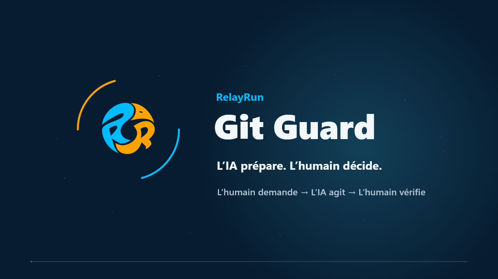

# Git Guard : collaboration Git avec l’IA et revue humaine

[Site officiel](https://www.relayrun.net/) · [Démarrage rapide](docs/fr/README.md) · [Compétences IA](skills/README.md)

[English](README.md) · [简体中文](README.zh-CN.md) · [日本語](README.ja.md) · [Deutsch](README.de.md) · [Français](README.fr.md) · [Español](README.es.md) · [Português (Brasil)](README.pt-BR.md) · [Русский](README.ru.md)

## 1. Découvrez Git Guard en 40 secondes

[Voir la vidéo en français · MP4 · 40 s](https://raw.githubusercontent.com/relayrun/gitguard/main/assets/videos/RelayRun-GitGuard-Intro-fr-v12.mp4)

## 2. L’IA prépare, les personnes décident

**Collaborer efficacement avec l’IA, tout en gardant la sécurité du dépôt sous contrôle humain.**

**Git Guard est un projet open source de [RelayRun](https://www.relayrun.net/) consacré à la collaboration avec Git.** Il fournit des manuels de configuration pour les personnes, des compétences réutilisables pour l’IA, des modèles et des exemples de déploiement. Il aide les développeurs individuels et les équipes à limiter les opérations risquées de l’IA et à conserver la revue et la fusion finales.

> [!NOTE]
> **Une personne demande → l’IA agit dans le périmètre autorisé → une personne vérifie le résultat.**

Il s’adresse aux personnes et équipes utilisant Git et l’IA pour modifier du code ou des documents. **OneDev et GitHub servent d’exemples de configuration, pas de liste exclusive de plateformes.** Les mêmes principes peuvent être adaptés à d’autres outils Git, en vérifiant leurs capacités et les effets réels des réglages.

## 3. Pourquoi Git Guard ?

L’IA peut modifier du code rapidement, mais aussi écraser l’historique par un push forcé, supprimer une branche ou modifier la branche principale sans revue. Avec des droits d’administration, elle peut également changer les règles censées protéger le dépôt.

Une consigne « ne fais pas cela » ne suffit pas. Les contrôles doivent reposer sur **les permissions du serveur, les voies d’accès et des sauvegardes indépendantes**. L’IA effectue le travail autorisé ; les personnes gardent les décisions importantes et les moyens de restauration.

## 4. Comment protéger le dépôt ?

| Mesure | Résultat recherché |
| --- | --- |
| Protéger la branche principale | L’IA peut pousser les branches de travail autorisées, mais pas directement sur main, réécrire son historique par push forcé ou supprimer les branches protégées. |
| Création, revue et fusion humaines sur le Web | L’IA prépare branche, titre et description. Une personne crée la demande dans OneDev/GitHub, examine les changements et effectue la fusion. |
| Limiter les voies de contournement | L’exemple OneDev auto-hébergé bloque l’API REST au proxy inverse et ferme l’accès direct au serveur ainsi que les autres voies de contournement. |
| Séparer contribution et administration | L’identité quotidienne de l’IA ne possède pas les droits de fusion finale, de modification des protections ou de gestion des sauvegardes, et n’emprunte pas la session d’un administrateur humain. |
| Conserver des copies indépendantes | Sauvegarder sur un appareil distinct ou un NAS, conserver des points de restauration historiques et vérifier leur intégrité. Compilation et démarrage restent facultatifs selon le projet. |

> [!WARNING]
> **Limites essentielles :** restreindre les push directs ou forcés de l’IA sur main et ses fusions autonomes ; bloquer REST et les autres accès susceptibles de contourner la revue, en réservant la décision finale aux personnes.

Ce sont des objectifs de configuration et de vérification, pas une preuve de protection déjà active. Consultez les [versions et limites OneDev](docs/fr/onedev.md#sources-and-limits) et les règles propres à la plateforme dans le [guide GitHub](docs/fr/github.md).

## 5. Se faire aider par l’IA pour la configuration

Suivez le manuel vous-même, ou confiez le manuel et la compétence adaptée à un assistant. **Privilégiez une utilisation visible de l’interface, par Computer Use :** observez les actions, accordez les droits nécessaires au périmètre prévu et saisissez vous-même les informations sensibles. Ensuite, fermez la session administrative temporaire et rendez à l’IA son identité quotidienne limitée.

| Environnement | Point de départ |
| --- | --- |
| OneDev auto-hébergé | [Manuel](docs/fr/onedev.md) · [Compétence de configuration et de vérification (anglais)](skills/gitguard-onedev-safety/SKILL.md) |
| GitHub | [Guide GitHub](docs/fr/github.md) |
| Autres plateformes Git | Adapter le [processus commun](docs/fr/workflow.md) et la [matrice de vérification](docs/fr/security-acceptance.md) à leurs permissions et interfaces. |

La configuration initiale comprend quatre points : définir dépôt, branche principale et identités distinctes ; configurer les protections ; vérifier opérations permises et refusées dans un dépôt de test isolé et autorisé ; organiser les [sauvegardes et la restauration](docs/fr/backup-and-recovery.md). Inutile de tout recommencer à chaque modification : revérifiez les parties concernées lorsque les droits, règles ou environnements changent.

### Vérifier les données sensibles avant le commit

Demandez à l’IA de suivre le [guide de revue du contenu public](docs/fr/public-content-review.md) : définir le périmètre publié et le mode du vérificateur, puis examiner séparément fichiers de travail, octets indexés et historique sortant. L’outil signale des clés possibles, chemins de machines, adresses réseau privées et problèmes similaires ; traitez-les et recontrôlez avant un commit ou push autorisé. Il ne supprime ni ne remplace le contenu et ne détecte pas toutes les informations privées ; images et vidéos exigent encore une revue humaine. Gardez les listes de secrets/comptes propres à l’organisation dans une configuration privée hors des dépôts. La [compétence de collaboration (anglais)](skills/gitguard-workflow/SKILL.md) précise les exigences opérationnelles.

## 6. Quatre étapes au quotidien

Utilisez la [compétence de collaboration (anglais)](skills/gitguard-workflow/SKILL.md) et le processus Git de votre projet.

| Étape | Ce que vous dites ou faites | Ce que fait l’IA |
| --- | --- | --- |
| 1. Commit local | « Exécute l’étape 1 selon Git.md. » | Lit le processus, vérifie les modifications et crée un commit local. Rien n’est encore envoyé. |
| 2. Push et préparation | « Exécute l’étape 2 selon Git.md. » | Pousse la branche autorisée et prépare titre, description et résultats des contrôles. |
| 3. Revue et fusion humaines | Créez la demande sur le Web ; vérifiez branches source et cible, titre, description, différences et contrôles ; puis fusionnez. | Fournit des explications et de l’aide. Une personne effectue la fusion finale. |
| 4. Clôture après fusion | « J’ai fusionné. Vérifie le résultat et effectue le nettoyage. » | Vérifie le contenu réellement intégré, synchronise main sans risque pour les travaux locaux et ne supprime que les branches confirmées terminées. |

`Git.md` désigne le document de votre projet ; son nom peut différer. Vous décidez quand créer un commit, pousser et fusionner. [Processus complet](docs/fr/workflow.md)

## 7. Les ressources disponibles

- [Démarrage rapide et sept guides en français](docs/fr/README.md) · [Couverture des huit langues](docs/README.md).
- [Deux compétences IA](skills/README.md) : collaboration quotidienne et configuration/vérification OneDev.
- [Modèles](templates/README.md) de transmission, descriptions et relevés de vérification.
- [Exemples de déploiement](examples/onedev/README.md) et [outils de contrôle et de création de paquets](scripts/README.md).
- [Intégration des vidéos et des langues](docs/fr/animation-and-language.md).

Compétences, modèles, exemples de déploiement et outils de contrôle restent des ressources communes en anglais.

## 8. Questions fréquentes et périmètre

### Faut-il refaire la configuration à chaque changement ?

Non. Suivez les quatre étapes quotidiennes et revérifiez les réglages concernés si les identités, permissions ou environnements changent.

### Peut-on utiliser Git Guard seul ?

Oui, en séparant les rôles humain/IA et les sessions temporaires de configuration des sessions quotidiennes. Si la plateforme exige une autre personne pour la revue, cette obligation reste applicable.

### Installer une compétence protège-t-il automatiquement le dépôt ?

Non. Les compétences guident le travail de l’IA ; les restrictions effectives nécessitent une configuration serveur et une [vérification des droits](docs/fr/security-acceptance.md).

### Quelles langues sont proposées ?

Présentations, démarrages rapides, les sept guides détaillés et vidéos correspondantes existent dans les huit langues. Voir le [périmètre linguistique](docs/README.md). Les traductions sont des versions à relire, sans validation linguistique native revendiquée.

Adaptez les documents, compétences et exemples à votre environnement. Les contrôles documentaires ne constituent pas une validation de sécurité réelle ; une version locale n’est pas une publication. [Crédits sonores](assets/videos/README.md) · [Contrôle du contenu public](docs/fr/public-content-review.md) · [Dépôt](https://github.com/relayrun/gitguard)

<!-- relayrun-footer -->

---

**[WWW.RELAYRUN.NET](https://www.relayrun.net/)**

© 2026 RelayRun

<!-- /relayrun-footer -->
