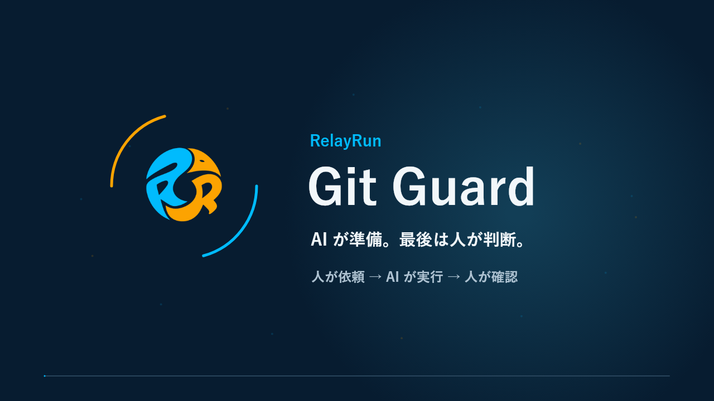

# Git Guard：AI と Git の協業、人によるレビュー

[公式サイト](https://www.relayrun.net/) · [クイックスタート](docs/ja/README.md) · [AI 用スキル](skills/README.md)

[English](README.md) · [简体中文](README.zh-CN.md) · [日本語](README.ja.md) · [Deutsch](README.de.md) · [Français](README.fr.md) · [Español](README.es.md) · [Português (Brasil)](README.pt-BR.md) · [Русский](README.ru.md)

## 1. 40秒でわかる Git Guard

[日本語の動画を見る · MP4 · 40秒](assets/videos/RelayRun-GitGuard-Intro-ja-v12.mp4)

## 2. AI が準備し、人が最後に判断する

**AI との協業を効率化し、リポジトリの安全性を人が管理する。**

**Git Guard は [RelayRun](https://www.relayrun.net/) のオープンソース Git 協業プロジェクトです。**人向けの設定手順書、AI 用スキル、テンプレート、導入例を提供します。個人やチームが AI の高リスクな操作を制限し、最終レビューとマージを人の手に残すための資料です。

> [!NOTE]
> **人が依頼する → AI が許可の範囲内で実行する → 人が結果を確認する。**

Git リポジトリでコードや文書を AI と編集する個人・チームが対象です。**OneDev と GitHub は設定例であり、対象プラットフォームを限定するものではありません。**他の Git 管理サービスでも同じ原則を参考にできますが、設定方法と効果は各サービスの機能に応じて確認します。

## 3. なぜ Git Guard が必要なのか

AI は素早くコードを変更できますが、強制 push による履歴の上書き、ブランチの誤削除、レビューなしの主ブランチ変更も起こり得ます。管理権限を持つ AI は、保護設定そのものを変更できる場合もあります。

「実行しないで」とプロンプトに書くだけでは不十分です。サーバーの権限、アクセス経路、独立したバックアップで制御し、AI には許可した作業を任せ、人が判断と復元手段を保持します。

## 4. どのように保護するのか

| 対策 | 目指す状態 |
| --- | --- |
| 主ブランチの保護 | AI は許可された作業ブランチを push できますが、主ブランチへの直接 push、履歴の強制上書き、保護ブランチの削除はできません。 |
| 人が Web 画面で依頼を作成し、レビュー・マージ | AI はブランチ、タイトル、説明を準備。人が OneDev／GitHub の Web 画面でリクエストを作成・確認し、最後にマージします。 |
| 迂回経路の制限 | 自前の OneDev の例ではリバースプロキシで REST API を制限し、バックエンドへの直接接続などの迂回経路も閉じます。 |
| 作業権限と管理権限の分離 | 日常の AI 用アカウントには最終マージ、保護ルール変更、バックアップ管理の権限を与えず、人の管理セッションも使わせません。 |
| 独立した復元用コピー | 別の機器や NAS に履歴付きでバックアップし、整合性を確認。ビルド・起動確認はプロジェクトに応じて選びます。 |

> [!WARNING]
> **重要な権限制限：**AI による主ブランチへの直接・強制 push と独断のマージを制限し、REST などレビューを迂回できる経路を閉じ、最終レビューとマージを人に残します。

これは設定と検証の目標であり、導入済みの保護を保証するものではありません。[OneDev の参考バージョンと制約](docs/ja/onedev.md#sources-and-limits)、[GitHub の対応設定](docs/ja/github.md)を確認してください。

## 5. 設定は AI に手伝ってもらえる

手順書に沿って自分で設定するほか、手順書とスキルを AI に渡して作業を依頼できます。**画面を見ながら操作する Computer Use を推奨します。**人が作業を確認し、必要な範囲だけ許可します。機密情報は人が入力し、完了後は一時的な管理セッションからログアウトして、AI を日常の制限されたアカウントに戻します。

| 利用環境 | 入口 |
| --- | --- |
| 自前の OneDev | [設定手順書](docs/ja/onedev.md) · [設定・安全性検証スキル（英語）](skills/gitguard-onedev-safety/SKILL.md) |
| GitHub | [GitHub ガイド](docs/ja/github.md) |
| その他の Git 管理サービス | [共通の協業手順](docs/ja/workflow.md)と[検証表](docs/ja/security-acceptance.md)を各サービスの機能に対応させます。 |

初回は、①リポジトリ・主ブランチ・人と AI のアカウントを決める、②設定する、③許可された隔離テスト用リポジトリで正常操作と拒否動作を検証する、④[独立バックアップと復元](docs/ja/backup-and-recovery.md)を用意する、の順に進めます。毎回すべてを設定し直す必要はなく、権限や環境の変更時に影響範囲を再確認します。

### コミット前に機密情報を点検する

AI に[公開内容の点検手順](docs/ja/public-content-review.md)に従うよう指示し、公開範囲とチェッカーのモードを決め、作業ファイル・ステージ内容・送出履歴を別々に確認します。ツールは秘密鍵の可能性、マシン固有パス、内部アドレスなどを検出する補助です。許可されたコミットや push の前に対応して再検査します。自動削除・置換や全ての機密情報の検出は行わず、画像・動画は人の点検が必要です。組織固有の秘密・アカウント照合リストはリポジトリ外の非公開設定に保持します。[協業スキル（英語）](skills/gitguard-workflow/SKILL.md)にも対応する操作要件があります。

## 6. 設定後の日常作業は4ステップ

[日常協業スキル（英語）](skills/gitguard-workflow/SKILL.md)とプロジェクトの Git 手順を使います。

| 手順 | 人が依頼・実行すること | AI が行うこと |
| --- | --- | --- |
| 1. ローカルコミット | 「Git.md のステップ1を実行して」 | 手順と変更内容を確認してローカルにコミット。まだ送信しません。 |
| 2. push と準備 | 「Git.md のステップ2を実行して」 | 許可された作業ブランチを push し、リクエストのタイトル・説明・検査結果を準備します。 |
| 3. 人によるレビューとマージ | Web 画面でリクエストを作成し、ソース・ターゲット、タイトル・説明、差分と検査を確認してマージします。 | 説明を補助します。最終マージは人が実行します。 |
| 4. マージ後の整理 | 「マージ済みです。結果を確認して後片付けして」 | 実際の統合内容を確認し、安全に主ブランチを同期。完了確認済みのブランチだけを整理します。 |

`Git.md` は実際のプロジェクトの手順書名に置き換えてください。コミット・push・マージのタイミングは人が決めます。[詳しい協業手順](docs/ja/workflow.md)

## 7. 提供する資料

- [日本語のクイックスタートと全7手順書](docs/ja/README.md) · [8言語の対応範囲](docs/README.md)。
- [2種類の AI 用スキル](skills/README.md)：日常協業と OneDev 設定・検証。
- [引き継ぎ・レビュー・検証テンプレート](templates/README.md)。
- [OneDev 導入例](examples/onedev/README.md)と[チェック・パッケージ化ツール](scripts/README.md)。
- [動画と言語の連携ガイド](docs/ja/animation-and-language.md)。

スキル、テンプレート、導入例、チェックツールは共通の英語資料です。

## 8. よくある質問と利用範囲

### 毎回設定し直す必要はありますか？

いいえ。通常は4ステップを使い、アカウント、権限、環境の変更時に関連設定を再確認します。

### 個人でも使えますか？

はい。人と AI、一時的な管理作業と日常作業を分けます。プラットフォームが別のレビュー担当者を要求する場合、その条件は守る必要があります。

### スキルを入れれば自動で保護されますか？

いいえ。スキルは AI の作業手順です。実際の制限にはサーバー側の設定と[権限の検証](docs/ja/security-acceptance.md)が必要です。

### どの言語を利用できますか？

8言語すべてに紹介・クイックスタート・7本の詳細手順書・対応動画を用意しています。[対応範囲](docs/README.md)をご確認ください。翻訳はレビュー用で、母語話者による校閲済みとはしていません。

資料・スキル・導入例は利用環境に合わせて調整してください。文書検査の合格は権限設定や実機検証の完了を意味せず、ローカルの更新は公開リリースではありません。[音効素材の出典](assets/videos/README.md) · [公開内容の点検](docs/ja/public-content-review.md) · [リポジトリ](https://github.com/relayrun/gitguard)

<!-- relayrun-footer -->

---

**[WWW.RELAYRUN.NET](https://www.relayrun.net/)**

© 2026 RelayRun

<!-- /relayrun-footer -->
