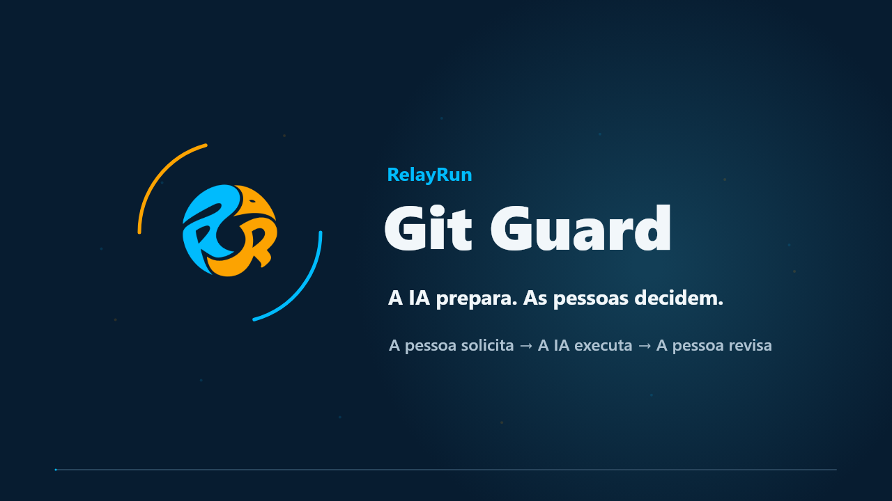

# Git Guard: colaboração com IA e Git sob revisão humana

[Site oficial](https://www.relayrun.net/) · [Início rápido](docs/pt-BR/README.md) · [Skills para IA](skills/README.md)

[English](README.md) · [简体中文](README.zh-CN.md) · [日本語](README.ja.md) · [Deutsch](README.de.md) · [Français](README.fr.md) · [Español](README.es.md) · [Português (Brasil)](README.pt-BR.md) · [Русский](README.ru.md)

## 1. Conheça o Git Guard em 40 segundos

[Assistir ao vídeo em português · MP4 · 40 s](assets/videos/RelayRun-GitGuard-Intro-pt-BR-v12.mp4)

## 2. A IA prepara. As pessoas decidem.

**Colabore com a IA de forma eficiente e mantenha a segurança do repositório sob controle humano.**

**Git Guard é um projeto de código aberto da [RelayRun](https://www.relayrun.net/) para colaboração com Git.** Ele oferece manuais de configuração para pessoas, skills reutilizáveis para IA, modelos e exemplos de implantação. Ajuda desenvolvedores individuais e equipes a limitar operações arriscadas da IA, deixando a revisão e o merge finais com as pessoas.

> [!NOTE]
> **Uma pessoa solicita → a IA executa dentro da autorização → uma pessoa confere o resultado.**

É voltado a pessoas e equipes que usam repositórios Git e IA para editar código ou documentação. **OneDev e GitHub são exemplos de configuração, não uma restrição de plataforma.** Outros gerenciadores Git podem adotar os mesmos princípios, verificando suas capacidades, configurações e resultados reais.

## 3. Por que Git Guard?

A IA pode alterar código rapidamente, mas também sobrescrever o histórico com um push forçado, apagar uma branch ou mudar a principal sem revisão. Com privilégios administrativos, ela pode até alterar as regras que deveriam proteger o repositório.

Uma instrução dizendo “não faça isso” não basta. Os controles precisam estar nas **permissões do servidor, nos caminhos de acesso e em backups independentes**. A IA executa o trabalho autorizado; as pessoas mantêm as decisões importantes e os meios de recuperação.

## 4. Como proteger o repositório?

| Medida | Resultado desejado |
| --- | --- |
| Proteger a branch principal | A IA pode enviar branches de trabalho autorizadas, mas não fazer push direto para main, sobrescrever seu histórico com push forçado ou apagar branches protegidas. |
| Criação, revisão e merge pela pessoa na web | A IA prepara branch, título e descrição. Uma pessoa cria o pedido no OneDev/GitHub, revisa as alterações e realiza o merge final. |
| Limitar caminhos alternativos | O exemplo de OneDev auto-hospedado bloqueia a API REST no proxy reverso e fecha o acesso direto ao servidor e outras rotas que contornem a revisão. |
| Separar contribuição e administração | A identidade cotidiana da IA não recebe permissões de merge final, alteração das proteções ou administração de backups, nem usa a sessão administrativa de uma pessoa. |
| Manter cópias independentes | Backups em outro dispositivo ou NAS, pontos históricos protegidos e verificação de integridade. Compilação e testes de inicialização são opcionais conforme o projeto. |

> [!WARNING]
> **Limites essenciais de permissão:** restringir pushes diretos ou forçados da IA para main e merges autônomos; fechar REST e outras rotas que possam contornar a revisão, deixando a revisão e o merge finais com as pessoas.

Esses são objetivos de configuração e aceitação, não provas de proteção já ativa. Consulte as [versões e limitações do OneDev](docs/pt-BR/onedev.md#sources-and-limits) e as regras próprias da plataforma no [guia do GitHub](docs/pt-BR/github.md).

## 5. A IA pode ajudar a configurar

Siga o manual ou entregue o manual e a skill adequada a um assistente. **Prefira Computer Use com interface visível:** acompanhe as ações, conceda somente as permissões necessárias e digite pessoalmente as credenciais sensíveis. Ao terminar, encerre a sessão administrativa temporária e devolva à IA sua identidade cotidiana restrita.

| Ambiente | Por onde começar |
| --- | --- |
| OneDev auto-hospedado | [Manual](docs/pt-BR/onedev.md) · [Skill de configuração e aceitação (inglês)](skills/gitguard-onedev-safety/SKILL.md) |
| GitHub | [Guia do GitHub](docs/pt-BR/github.md) |
| Outros gerenciadores Git | Adaptar o [fluxo compartilhado](docs/pt-BR/workflow.md) e a [matriz de aceitação](docs/pt-BR/security-acceptance.md) às permissões e interfaces disponíveis. |

A preparação inicial tem quatro partes: definir repositório, branch principal e identidades separadas; configurar os controles; testar ações permitidas e recusadas em um repositório isolado e autorizado; organizar [backups e recuperação](docs/pt-BR/backup-and-recovery.md). Não é preciso repetir tudo em cada alteração. Reavalie as partes afetadas quando permissões, regras ou ambiente mudarem.

### Revisar conteúdo sensível antes do commit

Peça à IA que siga o [guia de revisão de conteúdo público](docs/pt-BR/public-content-review.md): definir escopo de publicação e modo do verificador, depois examinar separadamente arquivos de trabalho, bytes preparados e histórico de saída. O auxiliar sinaliza possíveis chaves, caminhos de máquinas, endereços privados e problemas semelhantes; trate e confira novamente antes de commit ou push autorizado. Ele não apaga nem substitui conteúdo e não detecta toda informação privada; imagens e vídeos ainda precisam de revisão humana. Mantenha listas de segredos/contas da organização em configuração privada fora dos repositórios. A [habilidade de colaboração (inglês)](skills/gitguard-workflow/SKILL.md) apresenta as exigências operacionais.

## 6. Quatro passos no dia a dia

Use a [skill de colaboração (inglês)](skills/gitguard-workflow/SKILL.md) com o fluxo Git do seu projeto.

| Passo | O que você diz ou faz | O que a IA faz |
| --- | --- | --- |
| 1. Commit local | “Execute o passo 1 conforme Git.md.” | Lê o fluxo, confere as alterações e cria o commit local. Nada é enviado ainda. |
| 2. Push e preparação | “Execute o passo 2 conforme Git.md.” | Envia a branch autorizada e prepara título, descrição e resultados das verificações. |
| 3. Revisão e merge humanos | Crie o pedido na web; confira branches de origem e destino, título, descrição, diferenças e verificações; depois confirme o merge. | Explica e ajuda. Uma pessoa realiza o merge final. |
| 4. Limpeza após o merge | “Já fiz o merge. Confira o resultado e faça a limpeza.” | Verifica o conteúdo realmente integrado, sincroniza main com segurança e remove apenas branches confirmadas como concluídas. |

`Git.md` representa o documento real do projeto; o nome pode variar. Você decide quando fazer commit, push e merge. [Fluxo completo](docs/pt-BR/workflow.md)

## 7. Recursos disponíveis

- [Início rápido e sete manuais em português](docs/pt-BR/README.md) · [Cobertura dos oito idiomas](docs/README.md).
- [Duas skills para IA](skills/README.md): colaboração diária e configuração/aceitação do OneDev.
- [Modelos](templates/README.md) de entrega, descrições e registros de verificação.
- [Exemplos de implantação](examples/onedev/README.md) e [ferramentas de verificação e empacotamento](scripts/README.md).
- [Integração de vídeos e idiomas](docs/pt-BR/animation-and-language.md).

Habilidades, modelos, exemplos de implantação e ferramentas de verificação continuam como recursos compartilhados em inglês.

## 8. Perguntas frequentes e escopo

### É necessário configurar novamente a cada alteração?

Não. Siga os quatro passos cotidianos e confira os ajustes afetados quando identidades, permissões ou ambiente mudarem.

### Uma pessoa sozinha pode usar?

Sim, separando os papéis humano/IA e as sessões temporárias de configuração das sessões diárias. Se a plataforma exigir outra pessoa para revisar, essa exigência continua válida.

### Instalar uma skill protege automaticamente o repositório?

Não. Skills orientam a IA. Restrições efetivas exigem configuração do servidor e [verificação das permissões](docs/pt-BR/security-acceptance.md).

### Quais idiomas estão disponíveis?

Há apresentação, início rápido, os sete manuais detalhados e vídeo correspondente nos oito idiomas. Consulte a [cobertura](docs/README.md). As traduções são versões para revisão; não se afirma revisão editorial por falantes nativos.

Adapte documentos, skills e exemplos ao seu ambiente. Verificações documentais não comprovam segurança real; uma versão local não é uma publicação. [Créditos dos efeitos sonoros](assets/videos/README.md) · [Revisão de conteúdo público](docs/pt-BR/public-content-review.md) · [Repositório](https://github.com/relayrun/gitguard)

<!-- relayrun-footer -->

---

**[WWW.RELAYRUN.NET](https://www.relayrun.net/)**

© 2026 RelayRun

<!-- /relayrun-footer -->
