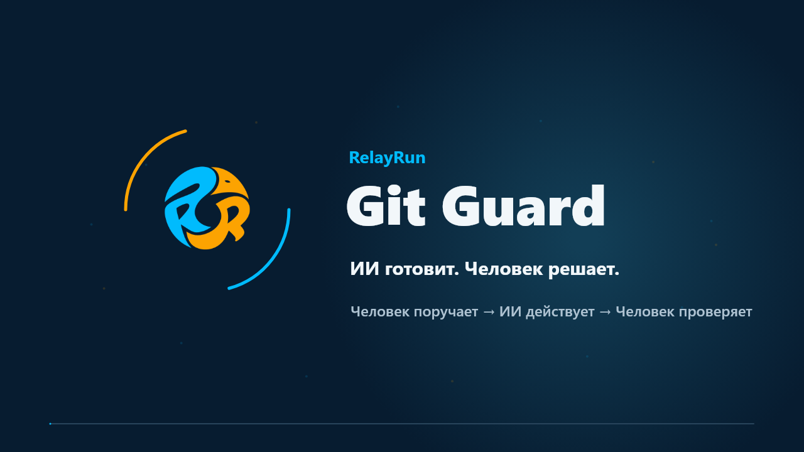

# Git Guard: совместная работа с ИИ и Git под контролем человека

[Официальный сайт](https://www.relayrun.net/) · [Быстрый старт](docs/ru/README.md) · [Навыки для ИИ](skills/README.md)

[English](README.md) · [简体中文](README.zh-CN.md) · [日本語](README.ja.md) · [Deutsch](README.de.md) · [Français](README.fr.md) · [Español](README.es.md) · [Português (Brasil)](README.pt-BR.md) · [Русский](README.ru.md)

## 1. Git Guard за 40 секунд

[Смотреть видео на русском · MP4 · 40 с](https://raw.githubusercontent.com/relayrun/gitguard/main/assets/videos/RelayRun-GitGuard-Intro-ru-v12.mp4)

## 2. ИИ готовит изменения. Человек принимает решение.

**Эффективно работайте с ИИ, сохраняя контроль над безопасностью репозитория.**

**Git Guard — открытый проект [RelayRun](https://www.relayrun.net/) для совместной работы с Git.** Он включает руководства по настройке для людей, навыки для ИИ, шаблоны и примеры развёртывания. Цель — помочь отдельным разработчикам и командам ограничить опасные действия ИИ, оставив окончательную проверку и слияние человеку.

> [!NOTE]
> **Человек ставит задачу → ИИ действует в пределах разрешения → человек проверяет результат.**

Проект предназначен для людей и команд, использующих Git и ИИ для изменения кода или документации. **OneDev и GitHub — примеры настройки, а не ограничение списка платформ.** Те же принципы можно применять в других системах управления Git, проверяя доступные возможности и фактическое действие ограничений.

## 3. Зачем нужен Git Guard?

ИИ быстро меняет код, но может столь же быстро перезаписать историю принудительным push, удалить ветку или изменить основную ветку без проверки. Получив права администратора, он может изменить и сами защитные настройки.

Одной инструкции «не делай этого» недостаточно. Контроль должен опираться на **права на сервере, пути доступа и независимые резервные копии**. ИИ выполняет разрешённую работу, а человек сохраняет важные решения и возможность восстановления.

## 4. Как защищается репозиторий?

| Мера | Ожидаемый результат |
| --- | --- |
| Защита основной ветки | ИИ может отправлять разрешённые рабочие ветки, но не делать прямой push в main, принудительно переписывать её историю или удалять защищённые ветки. |
| Создание запроса, проверка и слияние человеком | ИИ готовит ветку, заголовок и описание. Человек создаёт запрос в веб-интерфейсе OneDev/GitHub, проверяет изменения и выполняет слияние. |
| Ограничение обходных путей | Пример собственного OneDev ограничивает REST API на обратном прокси и закрывает прямой доступ к серверу и другие пути обхода проверки. |
| Разделение рабочих и административных прав | У повседневной учётной записи ИИ нет прав на окончательное слияние, изменение защиты или управление резервными копиями; она не использует административный сеанс человека. |
| Независимые копии для восстановления | Отдельное устройство или NAS, защищённые исторические точки восстановления и контроль целостности. Сборка и проверка запуска — по потребностям проекта. |

> [!WARNING]
> **Ключевые ограничения прав:** запретить ИИ прямой и принудительный push в main и самостоятельное слияние; закрыть REST и другие пути обхода проверки, оставив окончательную проверку и слияние человеку.

Это цели настройки и приёмки, а не доказательство уже действующей защиты. См. [версии и ограничения OneDev](docs/ru/onedev.md#sources-and-limits) и правила платформы в [руководстве GitHub](docs/ru/github.md).

## 5. ИИ может помочь с настройкой

Следуйте руководству самостоятельно либо передайте его и нужный навык помощнику. **Предпочтителен Computer Use с видимым интерфейсом:** наблюдайте за действиями, выдавайте необходимые для задачи права, вводите секретные данные сами. После настройки завершите временный административный сеанс и верните ИИ ограниченную повседневную учётную запись.

| Среда | С чего начать |
| --- | --- |
| Собственный OneDev | [Руководство](docs/ru/onedev.md) · [Навык настройки и приёмки (английский)](skills/gitguard-onedev-safety/SKILL.md) |
| GitHub | [Руководство GitHub](docs/ru/github.md) |
| Другие платформы Git | Сопоставьте [общий процесс](docs/ru/workflow.md) и [матрицу приёмки](docs/ru/security-acceptance.md) с их правами и интерфейсами. |

Первичная настройка включает четыре части: определить репозиторий, main и отдельные учётные записи; настроить ограничения; проверить разрешённые и запрещённые действия в согласованном изолированном тестовом репозитории; организовать [резервное копирование и восстановление](docs/ru/backup-and-recovery.md). Повторять всё при каждом изменении не нужно. Перепроверяйте затронутые части при изменении прав, правил или среды.

### Проверить чувствительные данные до коммита

Попросите ИИ следовать [руководству проверки публичного содержимого](docs/ru/public-content-review.md): определить объём выпуска и режим скрипта, отдельно проверить рабочие файлы, байты индекса и исходящую историю. Помощник отмечает возможные ключи, пути машин, частные адреса и подобные проблемы; обработайте находки и повторите проверку до разрешённого commit или push. Он не удаляет и не заменяет содержимое и не находит всю приватную информацию; изображения и видео требуют проверки человеком. Списки секретов/аккаунтов организации храните в приватной конфигурации вне репозиториев. [Навык рабочего процесса (английский)](skills/gitguard-workflow/SKILL.md) содержит соответствующие требования.

## 6. Четыре повседневных шага

Используйте [навык совместной работы (английский)](skills/gitguard-workflow/SKILL.md) и Git-процесс вашего проекта.

| Шаг | Что вы говорите или делаете | Что делает ИИ |
| --- | --- | --- |
| 1. Локальный коммит | «Выполни шаг 1 по Git.md». | Читает правила, проверяет изменения и создаёт локальный коммит. На сервер пока ничего не отправляется. |
| 2. Push и подготовка | «Выполни шаг 2 по Git.md». | Отправляет разрешённую рабочую ветку, готовит заголовок, описание и результаты проверок. |
| 3. Проверка и слияние человеком | Создайте запрос в веб-интерфейсе; проверьте исходную и целевую ветки, заголовок, описание, изменения и проверки; затем выполните слияние. | Предоставляет пояснения и помощь. Окончательное слияние выполняет человек. |
| 4. Завершение после слияния | «Я выполнил слияние. Проверь результат и сделай уборку». | Проверяет фактически включённый код, безопасно синхронизирует main и удаляет только подтверждённо завершённые ветки. |

`Git.md` означает реальный документ процесса в вашем проекте; имя может отличаться. Вы решаете, когда делать коммит, push и слияние. [Полный процесс](docs/ru/workflow.md)

## 7. Доступные материалы

- [Быстрый старт и семь руководств на русском](docs/ru/README.md) · [Охват восьми языков](docs/README.md).
- [Два навыка для ИИ](skills/README.md): ежедневная работа и настройка/приёмка OneDev.
- [Шаблоны](templates/README.md) передачи работы, описаний и записей проверок.
- [Примеры развёртывания](examples/onedev/README.md) и [инструменты проверки и упаковки](scripts/README.md).
- [Интеграция видео и языков](docs/ru/animation-and-language.md).

Навыки, шаблоны, примеры развёртывания и инструменты проверки остаются общими ресурсами на английском.

## 8. Частые вопросы и границы

### Нужно ли повторять настройку при каждом изменении?

Нет. Используйте четыре обычных шага и перепроверяйте затронутые настройки при изменении учётных записей, прав или среды.

### Подходит ли это одному разработчику?

Да, при разделении ролей человека и ИИ, временных административных и повседневных сеансов. Если платформа требует другого проверяющего, это требование остаётся в силе.

### Установка навыка автоматически защищает репозиторий?

Нет. Навыки направляют работу ИИ. Действующие ограничения требуют серверной настройки и [проверки прав](docs/ru/security-acceptance.md).

### Какие языки доступны?

Введение, быстрый старт, все семь подробных руководств и соответствующие видео есть на всех восьми языках. См. [охват переводов](docs/README.md). Переводы предназначены для проверки; редактура носителями языка не заявляется.

Адаптируйте документы, навыки и примеры к своей среде. Проверка документации не доказывает реальную безопасность настроек; локальная версия не является публикацией. [Источники звуков](assets/videos/README.md) · [Проверка публичного содержимого](docs/ru/public-content-review.md) · [Репозиторий](https://github.com/relayrun/gitguard)

<!-- relayrun-footer -->

---

**[WWW.RELAYRUN.NET](https://www.relayrun.net/)**

© 2026 RelayRun

<!-- /relayrun-footer -->
